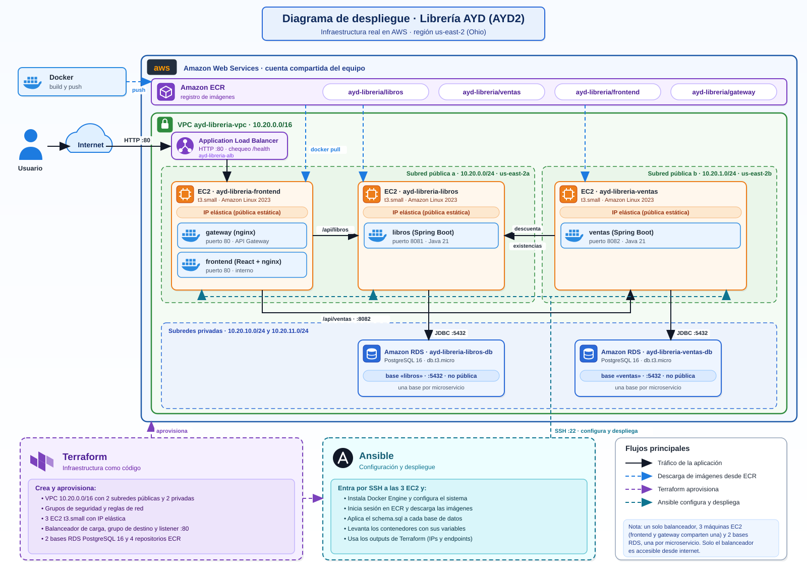
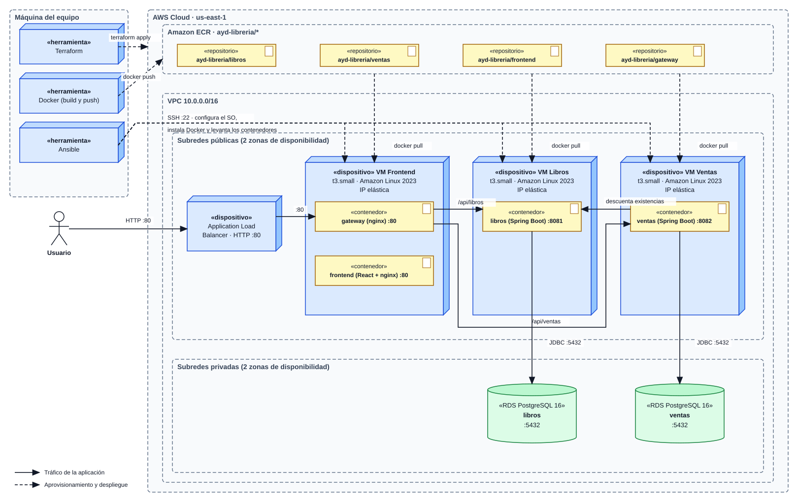

# Diagrama de despliegue

Despliegue de la Librería AYD en AWS y papel de Terraform, Docker y Ansible. Hay dos vistas: una general, con los nombres reales de los recursos, y otra en notación UML.

## Vista general

## Diagrama UML de despliegue

El archivo editable es [diagramas/despliegue-p2.drawio](diagramas/despliegue-p2.drawio) y se abre con draw.io.

## Componentes

Todo está en una VPC de `us-east-2` con subredes públicas y privadas en dos zonas de disponibilidad.

| Componente | Detalle |
|---|---|
| Application Load Balancer | Recibe el tráfico de internet en el puerto 80 y lo pasa al gateway. Usa `/health` como chequeo. |
| VM Frontend | Dos contenedores en la misma red de Docker. El gateway (nginx) publica el puerto 80 y el frontend no se expone. |
| VM Libros | Contenedor de Libros (Spring Boot) en el puerto 8081. |
| VM Ventas | Contenedor de Ventas (Spring Boot) en el puerto 8082. |
| IP elásticas | Una por máquina, para que la dirección no cambie al reiniciar. |
| RDS PostgreSQL 16 | Una base por microservicio, en subredes privadas y sin acceso público. |
| Amazon ECR | Cuatro repositorios con las imágenes: libros, ventas, frontend y gateway. |

## Flujo de una petición

El usuario llega al balanceador y este al gateway. El gateway sirve el frontend y reenvía `/api/libros` a Libros y `/api/ventas` a Ventas. Al registrar una venta, Ventas llama a Libros para descontar existencias. Cada servicio se conecta solo a su base, por el puerto 5432.

## Seguridad de red

| Destino | Puerto | Acepta conexiones de |
|---|---|---|
| Balanceador | 80 | Internet |
| Gateway (VM Frontend) | 80 | El balanceador |
| Libros | 8081 | El gateway y Ventas |
| Ventas | 8082 | El gateway |
| Base de cada servicio | 5432 | La máquina de ese servicio |
| SSH en las tres máquinas | 22 | La IP de quien despliega (`admin_cidr`) |

## Aprovisionamiento

Las líneas punteadas del diagrama son pasos que ejecuta el equipo, no tráfico de la aplicación.

Terraform crea la red, las máquinas, las IP elásticas, el balanceador, las bases y los repositorios de ECR. Docker construye las imágenes y las sube a ECR. Ansible entra por SSH a cada máquina, instala Docker Engine, descarga las imágenes, aplica el esquema SQL a cada base y levanta los contenedores con sus variables de entorno.

La región, la cuenta compartida y los nombres de cada recurso están en [aws.md](aws.md).
