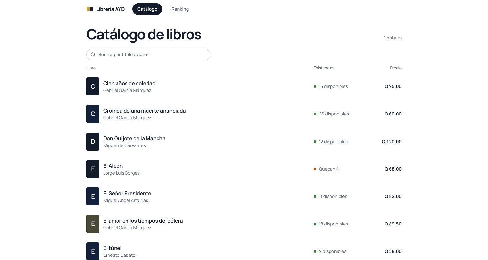
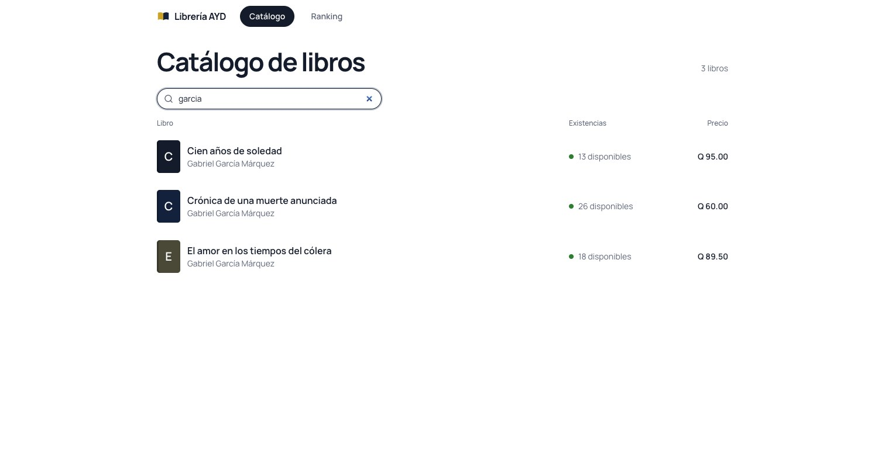
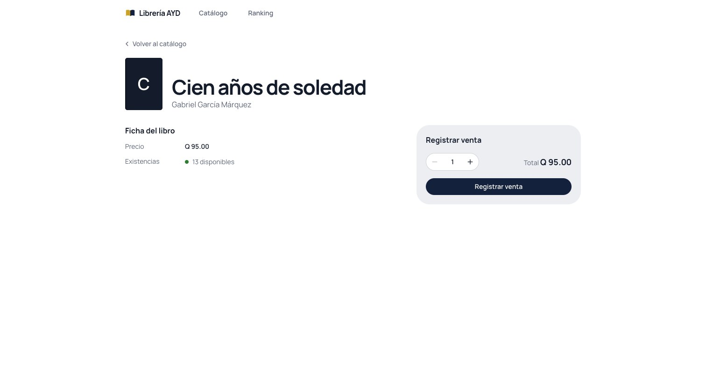
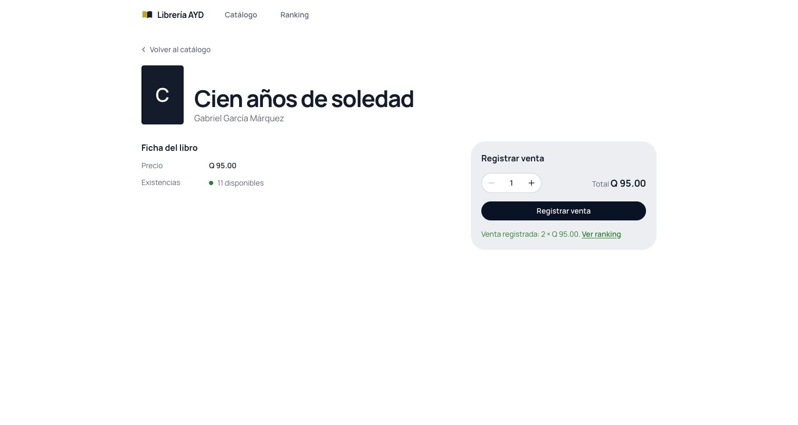
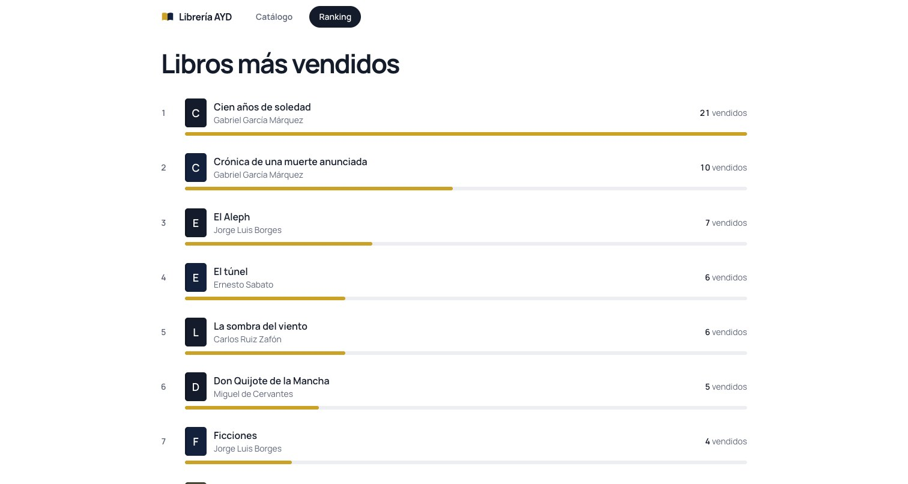

# Manual de usuario

Guía para consultar el catálogo de la Librería AYD, buscar libros, registrar una venta y ver cuáles son los más vendidos. No hace falta instalar nada ni iniciar sesión: basta un navegador.

## Entrar a la página

Abre en el navegador la dirección que te entregó el equipo, que es el nombre DNS del balanceador de carga (por ejemplo `http://<nombre-del-balanceador>`). Se abre el catálogo.

La barra de arriba tiene dos opciones: **Catálogo** y **Ranking**. La opción activa aparece resaltada en una píldora oscura.

## Ver el listado de libros

El catálogo muestra todos los libros en una lista, con el total de libros arriba a la derecha. Cada fila tiene una portada con la inicial del título, el título, el autor, las existencias y el precio en quetzales.

El estado de las existencias lleva un punto de color: verde cuando hay disponibles, naranja con **Quedan N** cuando son cinco o menos, y rojo con **Agotado** cuando no hay.

## Buscar por título o autor

Escribe en el cuadro **Buscar por título o autor** y la lista se filtra mientras escribes. La búsqueda no distingue mayúsculas ni acentos: `garcia` encuentra a Gabriel García Márquez y `aleph` encuentra *El Aleph*.

Si no hay coincidencias, aparece un mensaje que indica que ningún libro coincide con lo escrito. Para volver a ver todo, borra el texto del cuadro.

## Ver el detalle de un libro

Haz clic en una fila para abrir el detalle: portada, título, autor, precio y existencias, con el panel **Registrar venta** a la derecha. Para regresar usa **Volver al catálogo**.

## Registrar una venta

En el panel **Registrar venta** del detalle, elige la cantidad con los botones **−** y **+** (no puede superar las existencias). El **Total** se actualiza al cambiar la cantidad. Pulsa **Registrar venta**.

Aparece el mensaje **Venta registrada** con la cantidad y el precio, las existencias bajan y el enlace **Ver ranking** te lleva a la lista de más vendidos.

Si pides más ejemplares de los que hay, la venta se rechaza y se muestra el motivo. Si el servicio de libros no responde, aparece un aviso y puedes intentar de nuevo en unos segundos.

## Ver el ranking de más vendidos

La opción **Ranking** muestra los diez libros más vendidos, del primero al décimo, con el total de ejemplares vendidos. Se calcula con todas las ventas registradas, así que cada venta nueva puede cambiar el orden. Al hacer clic en un título vas a su detalle.

Si todavía no hay ventas, aparece **Todavía no hay ventas registradas**.
